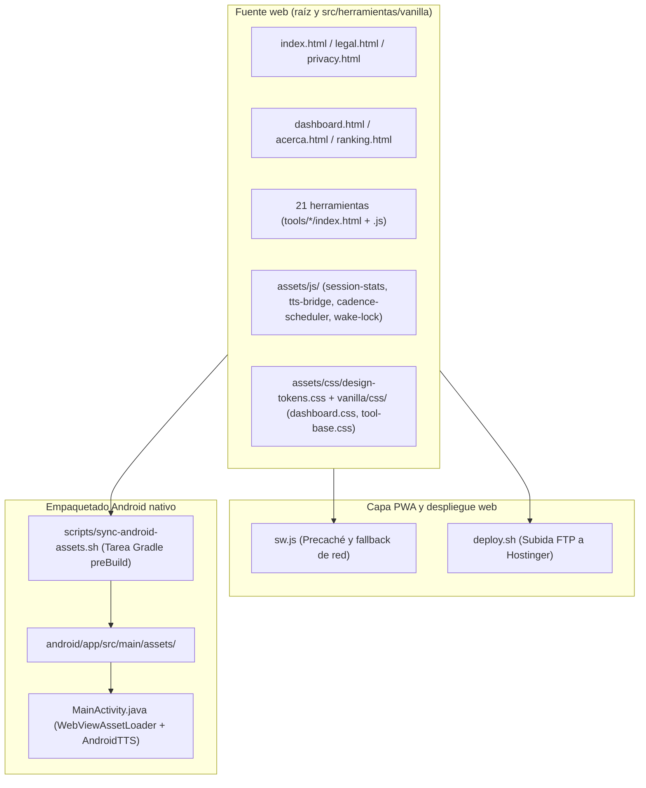

# Auditoría técnica y plan de mejoras de KinesisLab (ECM-cognitivo-motor)

- **Proyecto:** KinesisLab (`ECM-cognitivo-motor`)
- **Versión analizada:** `2.0.8` en [package.json](file:///d:/SOFTWARE/ECM-cognitivo-motor/package.json#L3) / `2.0.9` (`versionCode 14`) en [android/app/build.gradle](file:///d:/SOFTWARE/ECM-cognitivo-motor/android/app/build.gradle#L13-L14) / `kinesislab-cache-v16` en [sw.js](file:///d:/SOFTWARE/ECM-cognitivo-motor/sw.js#L1)
- **Fecha de auditoría:** 28 de octubre de 2026
- **Alcance:** Arquitectura global, las 21 herramientas en HTML/CSS/JS vanilla, módulos compartidos en [assets/js/](file:///d:/SOFTWARE/ECM-cognitivo-motor/assets/js), hojas de estilo y tokens de [DESIGN.md](file:///d:/SOFTWARE/ECM-cognitivo-motor/DESIGN.md), PWA ([sw.js](file:///d:/SOFTWARE/ECM-cognitivo-motor/sw.js), [manifest.json](file:///d:/SOFTWARE/ECM-cognitivo-motor/manifest.json)), empaquetado nativo Android ([MainActivity.java](file:///d:/SOFTWARE/ECM-cognitivo-motor/android/app/src/main/java/kinesislab/movimientofuncional/app/MainActivity.java), [build.gradle](file:///d:/SOFTWARE/ECM-cognitivo-motor/android/app/build.gradle), [sync-android-assets.sh](file:///d:/SOFTWARE/ECM-cognitivo-motor/scripts/sync-android-assets.sh)), SEO, páginas legales y suite de pruebas (Vitest y Playwright)

---

## Índice de contenidos

1. [Resumen ejecutivo](#1-resumen-ejecutivo)
2. [Arquitectura actual y flujo de datos](#2-arquitectura-actual-y-flujo-de-datos)
3. [Hallazgos críticos (prioridad inmediata)](#3-hallazgos-críticos-prioridad-inmediata)
4. [Hallazgos de gravedad alta](#4-hallazgos-de-gravedad-alta)
5. [Hallazgos de gravedad media](#5-hallazgos-de-gravedad-media)
6. [Hallazgos de gravedad baja y limpieza del repositorio](#6-hallazgos-de-gravedad-baja-y-limpieza-del-repositorio)
7. [Propuestas de mejora arquitectónica, rendimiento y mantenibilidad](#7-propuestas-de-mejora-arquitectónica-rendimiento-y-mantenibilidad)
8. [Hoja de ruta de remediación y criterios de aceptación](#8-hoja-de-ruta-de-remediación-y-criterios-de-aceptación)

---

## 1. Resumen ejecutivo

KinesisLab cuenta con una base funcional de 21 herramientas interactivas de entrenamiento cognitivo-motor en JavaScript puro sin dependencias de frameworks en tiempo de ejecución, complementada con soporte offline mediante Service Worker y una aplicación Android nativa con `WebViewAssetLoader` y puente `TextToSpeech`.

Sin embargo, la auditoría exhaustiva del código fuente ha revelado **fallos críticos y altos** que afectan directamente a la fiabilidad de las estadísticas guardadas, a la estabilidad de la suite de tests automatizados, a la seguridad del paquete de producción en Android y al funcionamiento offline en primera visita.

### Distribución de hallazgos por severidad

| Severidad | Cantidad | Áreas principales afectadas |
| :--- | :---: | :--- |
| **Crítico** | 4 | Suite de tests rota ([tts-bridge.js](file:///d:/SOFTWARE/ECM-cognitivo-motor/assets/js/tts-bridge.js#L144-L156)), cálculo de récords y pérdida de métricas en [session-stats.js](file:///d:/SOFTWARE/ECM-cognitivo-motor/assets/js/session-stats.js#L120-L127), depuración WebView activa en producción Android ([MainActivity.java](file:///d:/SOFTWARE/ECM-cognitivo-motor/android/app/src/main/java/kinesislab/movimientofuncional/app/MainActivity.java#L61)) |
| **Alto** | 9 | Métricas de precisión en historial, umbral de guardado en [memoria.js](file:///d:/SOFTWARE/ECM-cognitivo-motor/src/herramientas/vanilla/tools/memoria/memoria.js#L100-L115), condiciones de carrera en temporizadores, lógica de `nback`, `list-sorting`, `sort`, `arrows`, `trace`, `timers`, precaché en [sw.js](file:///d:/SOFTWARE/ECM-cognitivo-motor/sw.js#L92) y [sitemap.xml](file:///d:/SOFTWARE/ECM-cognitivo-motor/sitemap.xml#L1-L116) |
| **Medio** | 8 | Degradados y `border-left` prohibidos en [DESIGN.md](file:///d:/SOFTWARE/ECM-cognitivo-motor/DESIGN.md#L172-L175), contrastes WCAG 2.1 AA, fuentes ausentes, deriva de tokens CSS, accesibilidad por teclado, `100dvh` en iOS, textos legales y desajustes en modales de ayuda |
| **Bajo** | 5 | Desfase de números de versión y conteo de herramientas (20 frente a 21), código duplicado entre herramientas, artefactos binarios y scripts temporales en el repositorio |

---

## 2. Arquitectura actual y flujo de datos

El proyecto mantiene una única fuente de verdad para las herramientas en [src/herramientas/vanilla/](file:///d:/SOFTWARE/ECM-cognitivo-motor/src/herramientas/vanilla), que sirve tanto a la versión web desplegada por FTP como al contenedor Android mediante el script [scripts/sync-android-assets.sh](file:///d:/SOFTWARE/ECM-cognitivo-motor/scripts/sync-android-assets.sh).



---

## 3. Hallazgos críticos (prioridad inmediata)

### 3.1. [CRÍTICO-01] Fallo de `pnpm test` por excepciones asíncronas no capturadas en `tts-bridge.js`

- **Ubicación:** [assets/js/tts-bridge.js](file:///d:/SOFTWARE/ECM-cognitivo-motor/assets/js/tts-bridge.js#L144-L156), [assets/js/tts-bridge.js](file:///d:/SOFTWARE/ECM-cognitivo-motor/assets/js/tts-bridge.js#L240-L254) y [tests/unit/tts-bridge.test.js](file:///d:/SOFTWARE/ECM-cognitivo-motor/tests/unit/tts-bridge.test.js#L52-L57) (con tests de Android en `#L129-L147` y `#L180-L191`)
- **Explicación técnica:** En [assets/js/tts-bridge.js](file:///d:/SOFTWARE/ECM-cognitivo-motor/assets/js/tts-bridge.js#L144-L156), cuando `inAndroid` es verdadero, la función `poll()` ejecuta `if (typeof window.AndroidTTS.isReady === 'function' && window.AndroidTTS.isReady())` en la línea 149 sin comprobar previamente si `window.AndroidTTS` sigue definido, y reprograma `setTimeout(poll, 200)` en las líneas 153 y 155. El mismo acceso sin guarda ocurre en `waitForEngine(callback)` ([assets/js/tts-bridge.js](file:///d:/SOFTWARE/ECM-cognitivo-motor/assets/js/tts-bridge.js#L240-L254)), donde `tick()` evalúa `window.AndroidTTS.isReady` en la línea 243 y reprograma `setTimeout(tick, 100)`. En [tests/unit/tts-bridge.test.js](file:///d:/SOFTWARE/ECM-cognitivo-motor/tests/unit/tts-bridge.test.js#L129-L147) y `#L180-L191`, los tres tests que simulan `window.AndroidTTS` no definen `isReady()` ni usan temporizadores simulados (`fakeTimers`), dejando colgados los `setTimeout(poll, 200)`. Cuando el siguiente test ejecuta `delete window.AndroidTTS` dentro de `beforeEach` (`#L54`), los temporizadores vencen 200 ms después sobre `undefined` y lanzan tres excepciones `TypeError` no capturadas que hacen que `pnpm test` termine con código de salida `1`.
- **Solución propuesta:** Añadir una guarda defensiva sobre `window.AndroidTTS` tanto en `poll()` (`#L148`) como en `tick()` (`#L242`) de [assets/js/tts-bridge.js](file:///d:/SOFTWARE/ECM-cognitivo-motor/assets/js/tts-bridge.js#L148-L156):

```javascript
// En assets/js/tts-bridge.js (#L144-L156)
var poll = function () {
  if (!window.AndroidTTS) return;
  try {
    if (typeof window.AndroidTTS.isReady === 'function' && window.AndroidTTS.isReady()) {
      notifySpanishVoice();
      return;
    }
  } catch (_) {}
  if (++attempts < 50) setTimeout(poll, 200);
};
```

### 3.2. [CRÍTICO-02] El indicador «¡Nuevo récord personal!» nunca llega a activarse en ninguna herramienta

- **Ubicación:** [assets/js/session-stats.js](file:///d:/SOFTWARE/ECM-cognitivo-motor/assets/js/session-stats.js#L120-L124) y [assets/js/session-stats.js](file:///d:/SOFTWARE/ECM-cognitivo-motor/assets/js/session-stats.js#L358-L374) (consumido en [assets/js/session-stats-ui.js](file:///d:/SOFTWARE/ECM-cognitivo-motor/assets/js/session-stats-ui.js#L555))
- **Explicación técnica:** En `endSession()` ([assets/js/session-stats.js](file:///d:/SOFTWARE/ECM-cognitivo-motor/assets/js/session-stats.js#L122-L123)), se guarda primero la sesión actual en `localStorage` llamando a `saveSession(user, current.toolId, summary)` y, en la línea siguiente, se calcula la comparativa histórica mediante `buildComparison(user, current.toolId, summary)`. Dentro de `buildComparison` (`#L359`), la llamada `getBest(toolId, 'rtMedian')` inspecciona la lista de sesiones que **ya contiene la sesión recién guardada**. Como resultado, el mejor tiempo histórico devuelto (`best.rtMedian`) es como máximo igual al de la sesión actual (`current.rtMedian`), por lo que la condición `current.rtMedian < best.rtMedian` de la línea 372 evalúa siempre a `false`.
- **Solución propuesta:** Calcular `buildComparison(user, current.toolId, summary)` **antes** de ejecutar `saveSession(user, current.toolId, summary)` en [assets/js/session-stats.js](file:///d:/SOFTWARE/ECM-cognitivo-motor/assets/js/session-stats.js#L120-L126):

```javascript
// En assets/js/session-stats.js (#L120-L126)
if (summary && summary.total >= 5) {
  const user = getActiveUser();
  if (user) {
    comparison = buildComparison(user, current.toolId, summary);
    saveSession(user, current.toolId, summary);
  }
}
```

### 3.3. [CRÍTICO-03] Pérdida sistemática de métricas específicas de 9 herramientas al guardar en `localStorage`

- **Ubicación:** [assets/js/session-stats.js](file:///d:/SOFTWARE/ECM-cognitivo-motor/assets/js/session-stats.js#L112-L127) y los cierres de sesión en [d50.js](file:///d:/SOFTWARE/ECM-cognitivo-motor/src/herramientas/vanilla/tools/d50/d50.js#L108-L125), [fluency.js](file:///d:/SOFTWARE/ECM-cognitivo-motor/src/herramientas/vanilla/tools/fluency/fluency.js#L84-L100), [go-nogo.js](file:///d:/SOFTWARE/ECM-cognitivo-motor/src/herramientas/vanilla/tools/go-nogo/go-nogo.js#L141-L152), [matrix.js](file:///d:/SOFTWARE/ECM-cognitivo-motor/src/herramientas/vanilla/tools/matrix/matrix.js#L174-L180), [memoria.js](file:///d:/SOFTWARE/ECM-cognitivo-motor/src/herramientas/vanilla/tools/memoria/memoria.js#L100-L108), [nback.js](file:///d:/SOFTWARE/ECM-cognitivo-motor/src/herramientas/vanilla/tools/nback/nback.js#L118-L122), [search.js](file:///d:/SOFTWARE/ECM-cognitivo-motor/src/herramientas/vanilla/tools/search/search.js#L86-L95), [simon.js](file:///d:/SOFTWARE/ECM-cognitivo-motor/src/herramientas/vanilla/tools/simon/simon.js#L85-L89) y [tracking.js](file:///d:/SOFTWARE/ECM-cognitivo-motor/src/herramientas/vanilla/tools/tracking/tracking.js#L54-L60)
- **Explicación técnica:** `SessionStats.session.end()` serializa inmediatamente el resumen a JSON dentro de `localStorage` en la línea 122 y devuelve `{ summary, comparison }`. Las 9 herramientas afectadas asignan sus métricas avanzadas (`rtByDistance`, `switchCost`, `totalWords`, `postErrorSlowing`, `gridSize`, `efficiency`, `maxN`, `slope`, `maxStreak`) sobre `result.summary.config` **después** de haber llamado a `SessionStats.session.end()`. Esas propiedades existen en memoria para el modal inmediato, pero nunca se persisten en `localStorage` ni aparecen al exportar copias de seguridad.
- **Solución propuesta:** Permitir que `end(extraConfig)` en [assets/js/session-stats.js](file:///d:/SOFTWARE/ECM-cognitivo-motor/assets/js/session-stats.js#L116-L131) reciba un objeto opcional de metadatos finales que se fusione con `current.config` antes de invocar `computeSummary(current)`:

```javascript
// En assets/js/session-stats.js (#L116-L131)
end(extraConfig) {
  if (!current) return { summary: null, comparison: null };
  if (extraConfig && typeof extraConfig === 'object') {
    current.config = Object.assign({}, current.config, extraConfig);
  }
  const summary = computeSummary(current);
  let comparison = null;
  if (summary && summary.total >= 5) {
    const user = users.active();
    if (user) {
      comparison = buildComparison(user, current.toolId, summary);
      saveSession(user, current.toolId, summary);
    }
  }
  current = null;
  return { summary, comparison };
}
```

### 3.4. [CRÍTICO-04] Depuración remota de WebView activa en compilaciones de producción de Android

- **Ubicación:** [MainActivity.java](file:///d:/SOFTWARE/ECM-cognitivo-motor/android/app/src/main/java/kinesislab/movimientofuncional/app/MainActivity.java#L61) y [android/app/build.gradle](file:///d:/SOFTWARE/ECM-cognitivo-motor/android/app/build.gradle#L1-L35)
- **Explicación técnica:** La línea `WebView.setWebContentsDebuggingEnabled(true);` se ejecuta siempre en `onCreate()`, incluso en el paquete firmado `bundleRelease` destinado a Google Play. Esto expone el DOM, el almacenamiento `localStorage` y la ejecución de scripts en cualquier dispositivo donde se conecte depuración por USB.
- **Solución propuesta:** Habilitar `buildFeatures { buildConfig = true }` en [android/app/build.gradle](file:///d:/SOFTWARE/ECM-cognitivo-motor/android/app/build.gradle#L28) y condicionar la depuración en [MainActivity.java](file:///d:/SOFTWARE/ECM-cognitivo-motor/android/app/src/main/java/kinesislab/movimientofuncional/app/MainActivity.java#L61):

```java
// En MainActivity.java (#L61)
if (BuildConfig.DEBUG) {
    WebView.setWebContentsDebuggingEnabled(true);
}
```

---

## 4. Hallazgos de gravedad alta

### 4.1. [ALTO-01] Herramientas cuya métrica principal es la precisión (`accuracy`) no muestran récord ni media en el panel post-sesión

- **Ubicación:** [assets/js/session-stats.js](file:///d:/SOFTWARE/ECM-cognitivo-motor/assets/js/session-stats.js#L293-L374) y [assets/js/session-stats-ui.js](file:///d:/SOFTWARE/ECM-cognitivo-motor/assets/js/session-stats-ui.js#L540-L558)
- **Explicación técnica:** `buildHistory()` en [assets/js/session-stats-ui.js](file:///d:/SOFTWARE/ECM-cognitivo-motor/assets/js/session-stats-ui.js#L541-L543) comprueba `var useRT = config.primaryMetric === 'rtMedian'` y asigna `null` tanto a `best` como a `avg` cuando la métrica principal no es el tiempo de reacción. Por ello, en `matrix`, `memoria`, `nback`, `simon`, `boxing` y `comba` nunca se muestran la mejor marca ni la media de las últimas sesiones. Asimismo, `getBest()` (`#L293`) y `getTop()` (`#L344`) en [assets/js/session-stats.js](file:///d:/SOFTWARE/ECM-cognitivo-motor/assets/js/session-stats.js#L293-L344) consideran `lowerBetter` únicamente para `'rtMedian'`, olvidando `'ies'` (donde un valor menor también representa mejor rendimiento).
- **Solución propuesta:** Actualizar `getBest()` y `getTop()` en [assets/js/session-stats.js](file:///d:/SOFTWARE/ECM-cognitivo-motor/assets/js/session-stats.js#L293-L344) con `const lowerBetter = metric === 'rtMedian' || metric === 'ies';`, y modificar `buildHistory()` en [assets/js/session-stats-ui.js](file:///d:/SOFTWARE/ECM-cognitivo-motor/assets/js/session-stats-ui.js#L540-L558) para calcular y formatear tanto `rtMedian` (en `ms`) como `accuracy` (en `%`) según `config.primaryMetric`.

### 4.2. [ALTO-02] Las partidas perfectas de `memoria` en nivel fácil nunca se guardan por desajuste de umbrales (`total >= 5` frente a `total >= 3`)

- **Ubicación:** [assets/js/session-stats.js](file:///d:/SOFTWARE/ECM-cognitivo-motor/assets/js/session-stats.js#L120) frente a [memoria.js](file:///d:/SOFTWARE/ECM-cognitivo-motor/src/herramientas/vanilla/tools/memoria/memoria.js#L4-L111), [boxing.js](file:///d:/SOFTWARE/ECM-cognitivo-motor/src/herramientas/vanilla/tools/boxing/boxing.js#L168), [comba.js](file:///d:/SOFTWARE/ECM-cognitivo-motor/src/herramientas/vanilla/tools/comba/comba.js#L196), [fluency.js](file:///d:/SOFTWARE/ECM-cognitivo-motor/src/herramientas/vanilla/tools/fluency/fluency.js#L109), [list-sorting.js](file:///d:/SOFTWARE/ECM-cognitivo-motor/src/herramientas/vanilla/tools/list-sorting/list-sorting.js#L140), [matrix.js](file:///d:/SOFTWARE/ECM-cognitivo-motor/src/herramientas/vanilla/tools/matrix/matrix.js#L190), [simon.js](file:///d:/SOFTWARE/ECM-cognitivo-motor/src/herramientas/vanilla/tools/simon/simon.js#L98), [sort.js](file:///d:/SOFTWARE/ECM-cognitivo-motor/src/herramientas/vanilla/tools/sort/sort.js#L116) y [trace.js](file:///d:/SOFTWARE/ECM-cognitivo-motor/src/herramientas/vanilla/tools/trace/trace.js#L63)
- **Explicación técnica:** `endSession()` en [assets/js/session-stats.js](file:///d:/SOFTWARE/ECM-cognitivo-motor/assets/js/session-stats.js#L120) exige el número mágico `if (summary && summary.total >= 5)` para guardar una sesión en `localStorage`, mientras que las 9 herramientas citadas abren el modal de resultados a partir de `total >= 3`. En [memoria.js](file:///d:/SOFTWARE/ECM-cognitivo-motor/src/herramientas/vanilla/tools/memoria/memoria.js#L4-L111), el nivel inicial por defecto es `Fácil (3 parejas)`. Si la usuaria completa el tablero en 3 o 4 intentos (`attempts` = 3 o 4), el juego termina automáticamente con victoria y muestra el modal de estadísticas, pero **descarta silenciosamente la partida del historial y del ranking** por tener menos de 5 intentos.
- **Solución propuesta:** Reducir el umbral mínimo en [assets/js/session-stats.js](file:///d:/SOFTWARE/ECM-cognitivo-motor/assets/js/session-stats.js#L120) a `summary.total >= 3` (o permitir `minTrials` configurable al iniciar sesión con `SessionStats.session.start(toolId, config)`), alineando el criterio de persistencia con el de visualización del modal.

### 4.3. [ALTO-03] Condiciones de carrera y bucles duplicados por temporizadores `sleep()` y `setTimeout()` sin cancelar

- **Ubicación:**
  - [comba.js](file:///d:/SOFTWARE/ECM-cognitivo-motor/src/herramientas/vanilla/tools/comba/comba.js#L34-L360)
  - [boxing.js](file:///d:/SOFTWARE/ECM-cognitivo-motor/src/herramientas/vanilla/tools/boxing/boxing.js#L178-L322)
  - [simon.js](file:///d:/SOFTWARE/ECM-cognitivo-motor/src/herramientas/vanilla/tools/simon/simon.js#L55-L251)
  - [memoria.js](file:///d:/SOFTWARE/ECM-cognitivo-motor/src/herramientas/vanilla/tools/memoria/memoria.js#L50-L219)
  - [colores.js](file:///d:/SOFTWARE/ECM-cognitivo-motor/src/herramientas/vanilla/tools/colores/colores.js#L241-L243)
- **Explicación técnica:**
  1. En `comba.js` y `boxing.js`, el método `sleep(ms)` envuelve un `setTimeout` sin almacenar su identificador ni enlazar un `AbortController` (declarado en `comba.js#L34` pero nunca usado). Si se detiene la herramienta durante las pausas de 900 ms, 1500 ms o 5000 ms y se vuelve a pulsar `EMPEZAR`, el bucle `async` anterior despierta cuando `this.isRunning` ya vuelve a ser `true` y **se ejecutan dos bucles de locución y temporización en paralelo**.
  2. En `simon.js`, ni `playSequence()` ni los `setTimeout(() => this.nextRound(), 1000/1800)` de `handleTap()` (`#L198,L210,L211`) se cancelan al pausar o finalizar. Además, al pausar (`#L58`) se fuerza `this.phase = 'idle'`, por lo que al reanudar (`#L66`) siempre entra por la rama que repite toda la secuencia desde cero.
  3. En `memoria.js`, los `setTimeout` de 400 ms y 900 ms dentro de `checkMatch()` (`#L204-L218`) no se cancelan al pulsar `Reiniciar` o `Finalizar`, volteando o bloqueando cartas del tablero nuevo si se reinicia antes de 900 ms.
  4. En `colores.js`, `showBerubeBanner()` (`#L241-L243`) programa un `setTimeout` de 1800 ms sin guardar su ID, de modo que si se cambia de nivel o se reinicia antes de 1,8 s el temporizador antiguo oculta prematuramente el nuevo aviso.
- **Solución propuesta:** Incrementar un contador de generación (`this.runId = (this.runId || 0) + 1`) al iniciar, pausar o detener en cada herramienta, y almacenar los IDs de todos los `setTimeout` en un array `this.pendingTimers` que se vacíe con `clearTimeout` dentro de `stop()`, `pause()`, `reset()` y `finalize()`.

### 4.4. [ALTO-04] Cinco defectos funcionales en `nback` (estímulos acoplados, historial visible, sin `rt`, pausa incompleta y contradicción de instrucciones)

- **Ubicación:** [nback.js](file:///d:/SOFTWARE/ECM-cognitivo-motor/src/herramientas/vanilla/tools/nback/nback.js#L3-L471) y [nback/index.html](file:///d:/SOFTWARE/ECM-cognitivo-motor/src/herramientas/vanilla/tools/nback/index.html#L188-L225)
- **Explicación técnica:**
  1. **Acoplamiento total entre forma y color en niveles Fácil, Medio y Adaptativo:** `this.stimuli` ([nback.js](file:///d:/SOFTWARE/ECM-cognitivo-motor/src/herramientas/vanilla/tools/nback/nback.js#L15-L20)) contiene solo 4 elementos donde cada figura tiene asignado siempre el mismo color (`circle` siempre turquesa, `square` siempre rosa, etc.). En consecuencia, el nivel `Medio` («forma + color») es idéntico al `Fácil` («solo forma»), pues la forma nunca cambia de color salvo en el nivel `Difícil` (`dualFeature: true`).
  2. **Historial visual en pantalla (`#historyBar`):** La función `renderHistory()` (`#L460-L471`) dibuja en la parte inferior las últimas `n + 3` figuras presentadas, permitiendo a la usuaria comprobar visualmente cuál apareció hace `N` pasos en lugar de ejercitar la memoria de trabajo.
  3. **Ausencia de tiempos de reacción (`rt`):** `handleMatch()` (`#L357-L388`) registra `recordTrial({ correct: true })` sin calcular `performance.now() - this.trialShownAt`, dejando `rtMedian`, `ies` y `segments[].rtMedian` siempre en `null`.
  4. **Pausa sin evaluación del ensayo en curso:** Al reanudar tras una pausa (`#L94-L103`), `startEngine()` muestra inmediatamente un nuevo estímulo sin evaluar el que estaba en pantalla antes de pausar.
  5. **Contradicción entre instrucciones en pantalla, modal de ayuda y lógica `dualFeature`:** `applyInstructionText()` (`#L197-L208`) e [nback/index.html](file:///d:/SOFTWARE/ECM-cognitivo-motor/src/herramientas/vanilla/tools/nback/index.html#L220-L225) describen el nivel 3 como recordar posición/secuencia a 2 pasos, sin explicar que `dualFeature: true` (`#L6,L244-L254,L302`) exige pulsar cuando coincida forma **o** color (y que el generador `#L244-L254` impide que coincidan ambos a la vez).
- **Solución propuesta:** Desacoplar las 4 formas y los 4 colores en el generador de estímulos (16 combinaciones posibles), guardar `this.trialShownAt = performance.now()` en `showStimulus()` para pasar `rt: Math.round(performance.now() - this.trialShownAt)` en `handleMatch()`, ocultar `#historyBar` durante la serie activa y alinear el texto del modal de ayuda con la regla real de cada nivel.

### 4.5. [ALTO-05] Ordenación de tamaños errónea y respuestas activas durante la pausa en `list-sorting` y `sort`

- **Ubicación:** [list-sorting.js](file:///d:/SOFTWARE/ECM-cognitivo-motor/src/herramientas/vanilla/tools/list-sorting/list-sorting.js#L25-L345) y [sort.js](file:///d:/SOFTWARE/ECM-cognitivo-motor/src/herramientas/vanilla/tools/sort/sort.js#L46-L285)
- **Explicación técnica:**
  1. En [list-sorting.js](file:///d:/SOFTWARE/ECM-cognitivo-motor/src/herramientas/vanilla/tools/list-sorting/list-sorting.js#L42-L45), el catálogo `this.foods` asigna a `COL` un tamaño de `20`, superior a `MELÓN` (`17`), `SANDÍA` (`18`) y `CALABAZA` (`19`), penalizando respuestas que en el mundo real son correctas. Además, `pickItems()` (`#L200-L212`) escoge elementos consecutivos en la escala (como `NARANJA` 9, `MANZANA` 10 y `PATATA` 11), cuyos tamaños reales son indistinguibles.
  2. Tanto en `list-sorting.js` (`#L107-L113,L338`) como en `sort.js` (`#L82-L89,L278`), al pausar durante la fase `decide` los botones `VERDADERO` y `FALSO` permanecen activos y `handleAnswer()` no comprueba `if (!this.isPlaying) return;`, lo que permite responder en pausa y reactiva el temporizador en segundo plano.
  3. En `list-sorting.js`, `changeCount()` (`#L171`) y `changeSpeed()` (`#L175`) no reinician ni abortan la sesión en curso; lo mismo ocurre con `changeSpeed()` en `sort.js#L46`.
- **Solución propuesta:** Reubicar `COL` en `size: 15` (por debajo de `PIÑA`, `MELÓN`, `SANDÍA` y `CALABAZA`), exigir en `pickItems()` una diferencia mínima `Math.abs(a.size - b.size) >= 3` entre objetos seleccionados, añadir `if (!this.isPlaying || this.phase !== 'decide') return;` al inicio de `handleAnswer()` en ambos archivos e invocar `this.abortSessionIfRunning()` en `changeCount()` y `changeSpeed()`.

### 4.6. [ALTO-06] Interacción activa y registro de ensayos estando en pausa o detenido en `arrows` y `trace`

- **Ubicación:** [arrows/index.html](file:///d:/SOFTWARE/ECM-cognitivo-motor/src/herramientas/vanilla/tools/arrows/index.html#L62), [arrows.js](file:///d:/SOFTWARE/ECM-cognitivo-motor/src/herramientas/vanilla/tools/arrows/arrows.js#L95-L117), [trace/index.html](file:///d:/SOFTWARE/ECM-cognitivo-motor/src/herramientas/vanilla/tools/trace/index.html#L74) y [trace.js](file:///d:/SOFTWARE/ECM-cognitivo-motor/src/herramientas/vanilla/tools/trace/trace.js#L115-L176)
- **Explicación técnica:** El área de estímulo de ambas herramientas tiene un atributo `onclick` directo (`onclick="tool.runArrows()"` y `onclick="tool.runTrace()"`). Ni `runArrows()` ([arrows.js](file:///d:/SOFTWARE/ECM-cognitivo-motor/src/herramientas/vanilla/tools/arrows/arrows.js#L95)) ni `runTrace()` ([trace.js](file:///d:/SOFTWARE/ECM-cognitivo-motor/src/herramientas/vanilla/tools/trace/trace.js#L115)) verifican `if (!this.isPlaying) return;`. Tocar la zona central mientras la herramienta está detenida o en pausa genera nuevos estímulos, lanza locuciones TTS en `arrows`, avanza la secuencia alfanumérica en `trace` y, si la sesión estaba pausada (`this.sessionActive === true`), **añade ensayos espurios a las estadísticas de la sesión**.
- **Solución propuesta:** Añadir `if (!this.isPlaying) return;` en la primera línea de `runArrows()` ([arrows.js](file:///d:/SOFTWARE/ECM-cognitivo-motor/src/herramientas/vanilla/tools/arrows/arrows.js#L96)) y de `runTrace()` ([trace.js](file:///d:/SOFTWARE/ECM-cognitivo-motor/src/herramientas/vanilla/tools/trace/trace.js#L116)), o distinguir explícitamente entre toque manual del usuario y disparo automático del `CadenceScheduler`.

### 4.7. [ALTO-07] Bloqueo de controles en la preparación de `timers`, solapamiento con voz en `clock` y congelación post-respuesta

- **Ubicación:** [timers.js](file:///d:/SOFTWARE/ECM-cognitivo-motor/src/herramientas/vanilla/tools/timers/timers.js#L313-L315), [clock.js](file:///d:/SOFTWARE/ECM-cognitivo-motor/src/herramientas/vanilla/tools/clock/clock.js#L245-L343), [d50.js](file:///d:/SOFTWARE/ECM-cognitivo-motor/src/herramientas/vanilla/tools/d50/d50.js#L234-L259), [search.js](file:///d:/SOFTWARE/ECM-cognitivo-motor/src/herramientas/vanilla/tools/search/search.js#L249-L274), [matrix.js](file:///d:/SOFTWARE/ECM-cognitivo-motor/src/herramientas/vanilla/tools/matrix/matrix.js#L367-L420) y [ranking.html](file:///d:/SOFTWARE/ECM-cognitivo-motor/src/herramientas/vanilla/ranking.html#L284)
- **Explicación técnica:**
  1. En [timers.js](file:///d:/SOFTWARE/ECM-cognitivo-motor/src/herramientas/vanilla/tools/timers/timers.js#L313-L315), `renderPrep()` oculta todos los botones de `#toolbarRunning` durante la cuenta atrás inicial, impidiendo detener o cancelar el temporizador durante los hasta 20 segundos de preparación. Además, `timers` figura en el selector de [ranking.html](file:///d:/SOFTWARE/ECM-cognitivo-motor/src/herramientas/vanilla/ranking.html#L284) aunque no registra estadísticas en `session-stats.js`.
  2. En [clock.js](file:///d:/SOFTWARE/ECM-cognitivo-motor/src/herramientas/vanilla/tools/clock/clock.js#L285-L294), cuando se selecciona el modo `Solo voz`, el `CadenceScheduler` comienza a descontar el tiempo del ensayo antes de que `KinesisTTS` termine de pronunciar la hora (que toma entre 1,5 y 2 s), dejando menos de 1 segundo para responder en cadencias rápidas.
  3. En `clock.js`, `d50.js`, `search.js` y `matrix.js`, tras responder un ensayo la pantalla espera pasivamente hasta que vence el intervalo completo del `CadenceScheduler` (hasta 6 u 8 s) en lugar de avanzar tras una breve pausa de feedback.
- **Solución propuesta:** Mantener visible el botón `Detener` en `renderPrep()` de [timers.js](file:///d:/SOFTWARE/ECM-cognitivo-motor/src/herramientas/vanilla/tools/timers/timers.js#L313-L315), retirar `timers` de la lista `TOOLS` en [ranking.html](file:///d:/SOFTWARE/ECM-cognitivo-motor/src/herramientas/vanilla/ranking.html#L284), usar `KinesisTTS.speakAndWait()` antes de iniciar la ventana de respuesta en `clock.js` (modo voz) y reprogramar el siguiente tick del `CadenceScheduler` a 500 ms tras registrar respuesta en `clock`, `d50`, `search` y `matrix`.

### 4.8. [ALTO-08] Fallo de precaché offline en Service Worker (`sw.js`) por parámetros `?v=` y recursos omitidos

- **Ubicación:** [sw.js](file:///d:/SOFTWARE/ECM-cognitivo-motor/sw.js#L3-L106)
- **Explicación técnica:**
  1. `PRECACHE_URLS` registra las rutas sin query string (por ejemplo, `./src/herramientas/vanilla/css/tool-base.css`), pero los documentos HTML solicitan los archivos con sufijos de versión (`?v=2.0.12`, `?v=2.0.7`, etc.). Como `caches.match(event.request)` en [sw.js](file:///d:/SOFTWARE/ECM-cognitivo-motor/sw.js#L92) no utiliza `{ ignoreSearch: true }`, al abrir una herramienta sin conexión antes de haberla visitado con red la búsqueda en caché falla.
  2. No están incluidos en `PRECACHE_URLS` los archivos [legal.html](file:///d:/SOFTWARE/ECM-cognitivo-motor/legal.html), [privacy.html](file:///d:/SOFTWARE/ECM-cognitivo-motor/privacy.html), [acerca.html](file:///d:/SOFTWARE/ECM-cognitivo-motor/src/herramientas/vanilla/acerca.html), [ranking.html](file:///d:/SOFTWARE/ECM-cognitivo-motor/src/herramientas/vanilla/ranking.html) ni los logotipos `./assets/logo-negro.webp`, `./assets/logo-kinesislab-negro-texto.webp` y `./assets/logo-kinesislab-negro-hero.png`.
- **Solución propuesta:** Añadir las páginas y logotipos faltantes a `PRECACHE_URLS` y activar `{ ignoreSearch: true }` en [sw.js](file:///d:/SOFTWARE/ECM-cognitivo-motor/sw.js#L92):

```javascript
// En sw.js (#L91-L105)
event.respondWith(
  caches.match(event.request, { ignoreSearch: true }).then(cached => {
    const networkFetch = fetch(event.request).then(response => {
      if (response && response.status === 200 && response.type === 'basic') {
        const responseToCache = response.clone();
        caches.open(CACHE_NAME).then(cache => {
          cache.put(event.request, responseToCache);
        });
      }
      return response;
    }).catch(() => cached);

    return cached || networkFetch;
  })
);
```

### 4.9. [ALTO-09] `sitemap.xml` apunta a un dominio incorrecto e incluye URLs inexistentes (404)

- **Ubicación:** [sitemap.xml](file:///d:/SOFTWARE/ECM-cognitivo-motor/sitemap.xml#L1-L116)
- **Explicación técnica:**
  1. Todas las etiquetas `<loc>` utilizan el dominio `https://kinesislab.app/...` en lugar del dominio oficial de producción `https://kinesislab.movimientofuncional.app/` declarado en [robots.txt](file:///d:/SOFTWARE/ECM-cognitivo-motor/robots.txt#L12) e [index.html](file:///d:/SOFTWARE/ECM-cognitivo-motor/index.html#L17).
  2. Incluye rutas que devuelven HTTP 404, como `/src/herramientas/vanilla/index.html` (`#L11`, el archivo real es `dashboard.html`) y `/src/herramientas/vanilla/tools/stroop/index.html` (`#L31`, la carpeta real es `colores`).
  3. Omite `arrows`, `trace`, `list-sorting`, `acerca.html`, `ranking.html`, `legal.html` y `privacy.html`.
- **Solución propuesta:** Sustituir el dominio base por `https://kinesislab.movimientofuncional.app`, corregir las rutas de `dashboard.html` y `colores/index.html`, y añadir las entradas para las 21 herramientas y las páginas informativas y legales.

---

## 5. Hallazgos de gravedad media

### 5.1. [MEDIO-01] Uso de degradados y franjas laterales `border-left` prohibidos por `DESIGN.md`

- **Ubicación:**
  - Degradados en [dashboard.css](file:///d:/SOFTWARE/ECM-cognitivo-motor/src/herramientas/vanilla/css/dashboard.css#L561) (`#L561,L682,L1188-L1200,L1488,L1610,L1675`), [timers/index.html](file:///d:/SOFTWARE/ECM-cognitivo-motor/src/herramientas/vanilla/tools/timers/index.html#L133-L425) (12 declaraciones `linear-gradient` y `radial-gradient`) y [legal.html](file:///d:/SOFTWARE/ECM-cognitivo-motor/legal.html#L255).
  - Franjas `border-left` en [dashboard.css](file:///d:/SOFTWARE/ECM-cognitivo-motor/src/herramientas/vanilla/css/dashboard.css#L1413-L1429) (`.footer-nav-card`), [legal.html](file:///d:/SOFTWARE/ECM-cognitivo-motor/legal.html#L231-L238) y [landing.css](file:///d:/SOFTWARE/ECM-cognitivo-motor/assets/css/landing.css#L207-L285).
- **Explicación técnica:** [DESIGN.md](file:///d:/SOFTWARE/ECM-cognitivo-motor/DESIGN.md#L114-L175) prohíbe expresamente los degradados CSS y las franjas laterales `border-left` en tarjetas, exigiendo capas de color sólido (`--layer-bg-*`) y bordes completos (`1px solid`) o superiores (`border-top`).
- **Solución propuesta:** Reemplazar todos los `linear-gradient` y `radial-gradient` por fondos sólidos tokenizados (`var(--gris-800)`, `var(--turquesa-800)`, `var(--tulip-tree-500)`), y cambiar `border-left: 3px solid` en `.footer-nav-card` por un borde uniforme `border: 1px solid var(--gris-700)` con `border-top: 2px solid var(--turquesa-600)`.

### 5.2. [MEDIO-02] Incumplimientos de contraste WCAG 2.1 AA (ratio 2,28:1) y colores/fuentes fuera del sistema

- **Ubicación:** [dashboard.css](file:///d:/SOFTWARE/ECM-cognitivo-motor/src/herramientas/vanilla/css/dashboard.css#L633-L634) (`#L633,L827,L1533`), [comba/index.html](file:///d:/SOFTWARE/ECM-cognitivo-motor/src/herramientas/vanilla/tools/comba/index.html#L56), [memoria/index.html](file:///d:/SOFTWARE/ECM-cognitivo-motor/src/herramientas/vanilla/tools/memoria/index.html#L132), [nback/index.html](file:///d:/SOFTWARE/ECM-cognitivo-motor/src/herramientas/vanilla/tools/nback/index.html#L74), [timers/index.html](file:///d:/SOFTWARE/ECM-cognitivo-motor/src/herramientas/vanilla/tools/timers/index.html#L91) (`#L91,L143,L491,L562`) y [dashboard.html](file:///d:/SOFTWARE/ECM-cognitivo-motor/src/herramientas/vanilla/dashboard.html#L41) (`#L41,L211,L212`)
- **Explicación técnica:**
  1. Se emplea texto blanco (`#ffffff`) sobre fondo `--turquesa-600` (`#00bec8`), lo que arroja un ratio de contraste de **2,28:1** (muy por debajo del mínimo de 4,5:1 exigido por WCAG 2.1 AA y [DESIGN.md](file:///d:/SOFTWARE/ECM-cognitivo-motor/DESIGN.md#L120)).
  2. [dashboard.html](file:///d:/SOFTWARE/ECM-cognitivo-motor/src/herramientas/vanilla/dashboard.html#L41) utiliza en línea el color hexadecimal `#ff2d78` en lugar de los tokens `--rosa-*`.
  3. [timers/index.html](file:///d:/SOFTWARE/ECM-cognitivo-motor/src/herramientas/vanilla/tools/timers/index.html#L491) emplea `'Courier New', monospace` en vez de `Righteous` con `font-variant-numeric: tabular-nums`, y aplica `backdrop-filter: blur(12px)` en 4 tarjetas animadas (`#L143`), con riesgo de parpadeo o pantalla blanca en iOS Safari.
- **Solución propuesta:** Usar texto oscuro `color: var(--gris-900)` sobre fondos `var(--turquesa-600)` (ratio 9,2:1) o cambiar el fondo a `var(--turquesa-800)` (`#006369`) cuando el texto sea blanco (ratio 5,36:1); sustituir `#ff2d78` por `var(--rosa-500)`; eliminar `backdrop-filter: blur(12px)` en `timers/index.html` y usar `font-family: var(--font-display); font-variant-numeric: tabular-nums;` en el cronómetro.

### 5.3. [MEDIO-03] Cinco páginas omiten la carga de las fuentes `Righteous` y `ABeeZee`

- **Ubicación:** [dashboard.html](file:///d:/SOFTWARE/ECM-cognitivo-motor/src/herramientas/vanilla/dashboard.html#L14), [arrows/index.html](file:///d:/SOFTWARE/ECM-cognitivo-motor/src/herramientas/vanilla/tools/arrows/index.html#L11), [boxing/index.html](file:///d:/SOFTWARE/ECM-cognitivo-motor/src/herramientas/vanilla/tools/boxing/index.html#L11), [comba/index.html](file:///d:/SOFTWARE/ECM-cognitivo-motor/src/herramientas/vanilla/tools/comba/index.html#L11) y [trace/index.html](file:///d:/SOFTWARE/ECM-cognitivo-motor/src/herramientas/vanilla/tools/trace/index.html#L11)
- **Explicación técnica:** En estas cinco páginas el `<head>` carga únicamente la hoja de `Material+Symbols+Sharp` desde Google Fonts, omitiendo `Righteous` y `ABeeZee`. En navegadores web donde no estén instaladas localmente, toda la interfaz cae a `Arial` / `sans-serif`.
- **Solución propuesta:** Añadir en el `<head>` de las cinco páginas el enlace `<link href="https://fonts.googleapis.com/css2?family=Righteous&family=ABeeZee:ital@0;1&display=swap" rel="stylesheet">` igual que en el resto de herramientas.

### 5.4. [MEDIO-04] Triplicación y contradicción de tokens CSS entre `design-tokens.css`, `dashboard.css` y `tool-base.css`

- **Ubicación:** [assets/css/design-tokens.css](file:///d:/SOFTWARE/ECM-cognitivo-motor/assets/css/design-tokens.css#L1-L108), [dashboard.css](file:///d:/SOFTWARE/ECM-cognitivo-motor/src/herramientas/vanilla/css/dashboard.css#L1-L90), [tool-base.css](file:///d:/SOFTWARE/ECM-cognitivo-motor/src/herramientas/vanilla/css/tool-base.css#L1-L82) y [assets/css/landing.css](file:///d:/SOFTWARE/ECM-cognitivo-motor/assets/css/landing.css#L1-L326)
- **Explicación técnica:** Los bloques `:root` están triplicados con valores divergentes:
  - `--turquesa-800` y `--turquesa-900` tienen los valores antiguos `#155e75` / `#164e63` en `design-tokens.css` y `tool-base.css`, pero los valores accesibles de `DESIGN.md` (`#006369` / `#00484d`) en `dashboard.css`.
  - La escala `--space-1` a `--space-4` vale `4px, 8px, 12px, 16px` en `design-tokens.css`, pero `8px, 16px, 24px, 32px` en `dashboard.css` y `tool-base.css`.
  - Además, [assets/css/landing.css](file:///d:/SOFTWARE/ECM-cognitivo-motor/assets/css/landing.css) (326 líneas) es código muerto no importado por ningún HTML.
- **Solución propuesta:** Unificar todas las variables en [assets/css/design-tokens.css](file:///d:/SOFTWARE/ECM-cognitivo-motor/assets/css/design-tokens.css) con los valores oficiales de [DESIGN.md](file:///d:/SOFTWARE/ECM-cognitivo-motor/DESIGN.md), eliminar las redeclaraciones de `:root` en `dashboard.css` y `tool-base.css`, y borrar `assets/css/landing.css`.

### 5.5. [MEDIO-05] Carencias de accesibilidad por teclado, roles ARIA y `100dvh` en Safari iOS

- **Ubicación:** [tool-base.css](file:///d:/SOFTWARE/ECM-cognitivo-motor/src/herramientas/vanilla/css/tool-base.css#L266), [fluency/index.html](file:///d:/SOFTWARE/ECM-cognitivo-motor/src/herramientas/vanilla/tools/fluency/index.html#L98), [go-nogo/index.html](file:///d:/SOFTWARE/ECM-cognitivo-motor/src/herramientas/vanilla/tools/go-nogo/index.html#L184), [matrix/index.html](file:///d:/SOFTWARE/ECM-cognitivo-motor/src/herramientas/vanilla/tools/matrix/index.html#L148), [matrix.js](file:///d:/SOFTWARE/ECM-cognitivo-motor/src/herramientas/vanilla/tools/matrix/matrix.js#L64-L68), [memoria.js](file:///d:/SOFTWARE/ECM-cognitivo-motor/src/herramientas/vanilla/tools/memoria/memoria.js#L140-L154), [search.js](file:///d:/SOFTWARE/ECM-cognitivo-motor/src/herramientas/vanilla/tools/search/search.js#L223-L233), [reactive.js](file:///d:/SOFTWARE/ECM-cognitivo-motor/src/herramientas/vanilla/tools/reactive/reactive.js#L169), [sonidos.js](file:///d:/SOFTWARE/ECM-cognitivo-motor/src/herramientas/vanilla/tools/sonidos/sonidos.js#L144) y [timers/index.html](file:///d:/SOFTWARE/ECM-cognitivo-motor/src/herramientas/vanilla/tools/timers/index.html#L705-L786)
- **Explicación técnica:**
  1. `.view-execution` en [tool-base.css](file:///d:/SOFTWARE/ECM-cognitivo-motor/src/herramientas/vanilla/css/tool-base.css#L266) define `height: 100vh;` sin `height: 100dvh;`, causando que la barra de direcciones de Safari en iOS tape parcialmente la `stats-bar` inferior.
  2. Las celdas de `matrix`, las cartas de `memoria`, los estímulos de `search`, las tarjetas selectoras de `timers` y las zonas de toque de `fluency` y `go-nogo` son elementos `<div>` con `onclick` que carecen de `role="button"`, `tabindex="0"` y manejador de teclado (`Enter` / `Space`).
  3. Faltan atributos `aria-label` en `#directionSelect` ([matrix/index.html](file:///d:/SOFTWARE/ECM-cognitivo-motor/src/herramientas/vanilla/tools/matrix/index.html#L148)) y en los `<input type="text">` dinámicos de [reactive.js](file:///d:/SOFTWARE/ECM-cognitivo-motor/src/herramientas/vanilla/tools/reactive/reactive.js#L169) y [sonidos.js](file:///d:/SOFTWARE/ECM-cognitivo-motor/src/herramientas/vanilla/tools/sonidos/sonidos.js#L144).
- **Solución propuesta:** Añadir `height: 100dvh;` tras `height: 100vh;` en [tool-base.css](file:///d:/SOFTWARE/ECM-cognitivo-motor/src/herramientas/vanilla/css/tool-base.css#L266), incorporar `role="button" tabindex="0"` y soporte de `keydown` (`Enter` y ` `) en las zonas interactivas, y añadir `aria-label` descriptivos en los controles de `matrix`, `reactive` y `sonidos`.

### 5.6. [MEDIO-06] Permiso `INTERNET` innecesario, audio activo en segundo plano y botón «Atrás» en Android

- **Ubicación:** [AndroidManifest.xml](file:///d:/SOFTWARE/ECM-cognitivo-motor/android/app/src/main/AndroidManifest.xml#L4) y [MainActivity.java](file:///d:/SOFTWARE/ECM-cognitivo-motor/android/app/src/main/java/kinesislab/movimientofuncional/app/MainActivity.java#L136-L157)
- **Explicación técnica:**
  1. [AndroidManifest.xml](file:///d:/SOFTWARE/ECM-cognitivo-motor/android/app/src/main/AndroidManifest.xml#L4) declara `<uses-permission android:name="android.permission.INTERNET" />`, contradiciendo [CLAUDE.md](file:///d:/SOFTWARE/ECM-cognitivo-motor/CLAUDE.md#L87) («Sin permisos, app 100% offline»).
  2. [MainActivity.java](file:///d:/SOFTWARE/ECM-cognitivo-motor/android/app/src/main/java/kinesislab/movimientofuncional/app/MainActivity.java#L148-L157) no implementa `onPause()` ni `onResume()` para pausar el `WebView` ni para detener `ttsBridge`. Al bloquear la pantalla o cambiar de app en mitad de una serie, los pitidos y las instrucciones habladas continúan ejecutándose en segundo plano.
  3. El callback de `OnBackPressedDispatcher` (`#L136-L146`) ejecuta `webView.goBack()` directamente sin cerrar antes los modales abiertos (`#infoModal`, `#resultsOverlay` o `#userSelectorOverlay`).
- **Solución propuesta:** Eliminar la línea `<uses-permission android:name="android.permission.INTERNET" />` de [AndroidManifest.xml](file:///d:/SOFTWARE/ECM-cognitivo-motor/android/app/src/main/AndroidManifest.xml#L4), y añadir la gestión de ciclo de vida en [MainActivity.java](file:///d:/SOFTWARE/ECM-cognitivo-motor/android/app/src/main/java/kinesislab/movimientofuncional/app/MainActivity.java#L148-L157):

```java
// En MainActivity.java
@Override
protected void onPause() {
    if (ttsBridge != null) {
        ttsBridge.cancel();
    }
    if (webView != null) {
        webView.onPause();
        webView.pauseTimers();
    }
    super.onPause();
}

@Override
protected void onResume() {
    super.onResume();
    if (webView != null) {
        webView.onResume();
        webView.resumeTimers();
    }
}
```

### 5.7. [MEDIO-07] Enlace roto `legal.html#cookies` e información inexacta sobre `localStorage` en páginas legales

- **Ubicación:** [legal.html](file:///d:/SOFTWARE/ECM-cognitivo-motor/legal.html#L343-L357) (`#L343,L353,L517`), [privacy.html](file:///d:/SOFTWARE/ECM-cognitivo-motor/privacy.html#L89-L109), [index.html](file:///d:/SOFTWARE/ECM-cognitivo-motor/index.html#L705), [acerca.html](file:///d:/SOFTWARE/ECM-cognitivo-motor/src/herramientas/vanilla/acerca.html#L155) y [assets/js/session-stats.js](file:///d:/SOFTWARE/ECM-cognitivo-motor/assets/js/session-stats.js#L34-L38)
- **Explicación técnica:**
  1. Los pies de página enlazan a `legal.html#cookies`, pero el encabezado `<h3>Cookies</h3>` en [legal.html](file:///d:/SOFTWARE/ECM-cognitivo-motor/legal.html#L353) no tiene el atributo `id="cookies"`.
  2. [legal.html](file:///d:/SOFTWARE/ECM-cognitivo-motor/legal.html#L343) y [privacy.html](file:///d:/SOFTWARE/ECM-cognitivo-motor/privacy.html#L89) indican que no se almacenan perfiles ni historiales, cuando [assets/js/session-stats.js](file:///d:/SOFTWARE/ECM-cognitivo-motor/assets/js/session-stats.js#L34-L38) guarda en `localStorage` las claves `kineslab:users`, `kineslab:activeUser` y `kineslab:user:<user>:sessions:<tool>` (hasta 50 sesiones por herramienta y usuaria).
  3. El correo de contacto difiere entre [legal.html](file:///d:/SOFTWARE/ECM-cognitivo-motor/legal.html#L300) (`info@movimientofuncional.com`) y [privacy.html](file:///d:/SOFTWARE/ECM-cognitivo-motor/privacy.html#L109) (`info@movimientofuncional.app`).
- **Solución propuesta:** Añadir `id="cookies"` al `<h3 id="cookies">Cookies</h3>` en [legal.html](file:///d:/SOFTWARE/ECM-cognitivo-motor/legal.html#L353), detallar en `legal.html` y `privacy.html` que los alias de perfil e historiales de sesiones se guardan exclusivamente en el `localStorage` del dispositivo sin enviarse a servidores externos, y unificar el correo de contacto en ambos documentos.

### 5.8. [MEDIO-08] Desajustes en 6 modales de ayuda, erratas ortográficas y calcos de puntuación

- **Ubicación:** [colores/index.html](file:///d:/SOFTWARE/ECM-cognitivo-motor/src/herramientas/vanilla/tools/colores/index.html#L175-L204), [d50/index.html](file:///d:/SOFTWARE/ECM-cognitivo-motor/src/herramientas/vanilla/tools/d50/index.html#L124-L132), [flechas/index.html](file:///d:/SOFTWARE/ECM-cognitivo-motor/src/herramientas/vanilla/tools/flechas/index.html#L135-L139), [matrix/index.html](file:///d:/SOFTWARE/ECM-cognitivo-motor/src/herramientas/vanilla/tools/matrix/index.html#L169-L216), [reactive/index.html](file:///d:/SOFTWARE/ECM-cognitivo-motor/src/herramientas/vanilla/tools/reactive/index.html#L208), [tracking/index.html](file:///d:/SOFTWARE/ECM-cognitivo-motor/src/herramientas/vanilla/tools/tracking/index.html#L92-L133), [comba/index.html](file:///d:/SOFTWARE/ECM-cognitivo-motor/src/herramientas/vanilla/tools/comba/index.html#L133), [simon/index.html](file:///d:/SOFTWARE/ECM-cognitivo-motor/src/herramientas/vanilla/tools/simon/index.html#L85), [trace/index.html](file:///d:/SOFTWARE/ECM-cognitivo-motor/src/herramientas/vanilla/tools/trace/index.html#L123) y [fluency.js](file:///d:/SOFTWARE/ECM-cognitivo-motor/src/herramientas/vanilla/tools/fluency/fluency.js#L93)
- **Explicación técnica:**
  1. Los modales de ayuda de [colores/index.html](file:///d:/SOFTWARE/ECM-cognitivo-motor/src/herramientas/vanilla/tools/colores/index.html#L175-L204) (omite el 5.º nivel `Stroop inverso`), [d50/index.html](file:///d:/SOFTWARE/ECM-cognitivo-motor/src/herramientas/vanilla/tools/d50/index.html#L124-L132) (omite `Resta` y `Mixto`), [flechas/index.html](file:///d:/SOFTWARE/ECM-cognitivo-motor/src/herramientas/vanilla/tools/flechas/index.html#L135-L139) (omite `Mezcla 60/20/20` y `Visual + Voz`), [matrix/index.html](file:///d:/SOFTWARE/ECM-cognitivo-motor/src/herramientas/vanilla/tools/matrix/index.html#L169-L216) (omite la casilla `Trampa`), [reactive/index.html](file:///d:/SOFTWARE/ECM-cognitivo-motor/src/herramientas/vanilla/tools/reactive/index.html#L208) (menciona «turquesa y dorado» cuando los estímulos por defecto son `AZUL` y `ROJO`) y [tracking/index.html](file:///d:/SOFTWARE/ECM-cognitivo-motor/src/herramientas/vanilla/tools/tracking/index.html#L92-L133) (omite el selector `Ocular / Cabeza`) están desactualizados respecto a los controles reales.
  2. Existen erratas en [comba/index.html](file:///d:/SOFTWARE/ECM-cognitivo-motor/src/herramientas/vanilla/tools/comba/index.html#L133) (`Duracion`), [simon/index.html](file:///d:/SOFTWARE/ECM-cognitivo-motor/src/herramientas/vanilla/tools/simon/index.html#L85) (`Record`), [trace/index.html](file:///d:/SOFTWARE/ECM-cognitivo-motor/src/herramientas/vanilla/tools/trace/index.html#L123) (`post-l&eacute;si&oacute;n`) y en [fluency.js](file:///d:/SOFTWARE/ECM-cognitivo-motor/src/herramientas/vanilla/tools/fluency/fluency.js#L93) (concatena `+${switchCost} ms` produciendo `+-XX ms` cuando `switchCost` es negativo).
  3. Se abusa de guiones largos (`&mdash;` / `—`) para incisos y de flechas de texto (`→`, `&#9654;`) en lugar de puntuación genuina en español e iconos `Material Symbols Sharp`.
- **Solución propuesta:** Actualizar los textos de los 6 modales de ayuda para reflejar todos los modos y controles vigentes, corregir las tres erratas ortográficas, formatear el signo de `switchCost` en [fluency.js](file:///d:/SOFTWARE/ECM-cognitivo-motor/src/herramientas/vanilla/tools/fluency/fluency.js#L93) con `${switchCost >= 0 ? '+' : ''}${switchCost} ms`, y reemplazar las entidades `&mdash;` y flechas Unicode por comas explicativas e iconos `<span class="material-symbols-sharp">`.

---

## 6. Hallazgos de gravedad baja y limpieza del repositorio

### 6.1. [BAJO-01] Inconsistencia en el número total de herramientas (20 frente a 21)

- **Ubicación:** [CLAUDE.md](file:///d:/SOFTWARE/ECM-cognitivo-motor/CLAUDE.md#L27) (`#L27,L76,L81`), [index.html](file:///d:/SOFTWARE/ECM-cognitivo-motor/index.html#L6) (`#L6,L21,L26,L59,L373`), [acerca.html](file:///d:/SOFTWARE/ECM-cognitivo-motor/src/herramientas/vanilla/acerca.html#L34) y [docs/ANDROID.md](file:///d:/SOFTWARE/ECM-cognitivo-motor/docs/ANDROID.md#L3) (`#L3,L131,L137`)
- **Explicación técnica:** Existen 21 herramientas reales en [src/herramientas/vanilla/tools/](file:///d:/SOFTWARE/ECM-cognitivo-motor/src/herramientas/vanilla/tools) y en [dashboard.html](file:///d:/SOFTWARE/ECM-cognitivo-motor/src/herramientas/vanilla/dashboard.html), pero los metadatos SEO, textos descriptivos y documentación técnica siguen indicando `20 herramientas`.
- **Solución propuesta:** Actualizar todas las menciones de `20 herramientas` a `21 herramientas` en [index.html](file:///d:/SOFTWARE/ECM-cognitivo-motor/index.html), [acerca.html](file:///d:/SOFTWARE/ECM-cognitivo-motor/src/herramientas/vanilla/acerca.html), [CLAUDE.md](file:///d:/SOFTWARE/ECM-cognitivo-motor/CLAUDE.md) y [docs/ANDROID.md](file:///d:/SOFTWARE/ECM-cognitivo-motor/docs/ANDROID.md).

### 6.2. [BAJO-02] Fragmentación de versiones y sufijos de caché

- **Ubicación:** [package.json](file:///d:/SOFTWARE/ECM-cognitivo-motor/package.json#L3), [android/app/build.gradle](file:///d:/SOFTWARE/ECM-cognitivo-motor/android/app/build.gradle#L13-L14), [COMPILAR-AAB.bat](file:///d:/SOFTWARE/ECM-cognitivo-motor/COMPILAR-AAB.bat#L8), [sw.js](file:///d:/SOFTWARE/ECM-cognitivo-motor/sw.js#L1) y etiquetas `<link>` / `<script>` de los HTML
- **Explicación técnica:** Conviven `2.0.8` en [package.json](file:///d:/SOFTWARE/ECM-cognitivo-motor/package.json#L3), `2.0.9` en [android/app/build.gradle](file:///d:/SOFTWARE/ECM-cognitivo-motor/android/app/build.gradle#L14), `kinesislab-cache-v16` en [sw.js](file:///d:/SOFTWARE/ECM-cognitivo-motor/sw.js#L1) y cinco sufijos `?v=` distintos (`2.0.5`, `2.0.6`, `2.0.7`, `2.0.10`, `2.0.12`) repartidos por los HTML.
- **Solución propuesta:** Sincronizar la versión en [package.json](file:///d:/SOFTWARE/ECM-cognitivo-motor/package.json#L3), [android/app/build.gradle](file:///d:/SOFTWARE/ECM-cognitivo-motor/android/app/build.gradle#L14) y todos los parámetros `?v=` mediante un script único ejecutado desde `package.json`.

### 6.3. [BAJO-03] Artefactos binarios y borradores de investigación versionados en Git

- **Ubicación:** [assets/kinesislab.apk](file:///d:/SOFTWARE/ECM-cognitivo-motor/assets/kinesislab.apk), [temp2.md](file:///d:/SOFTWARE/ECM-cognitivo-motor/temp2.md), [Entrenamiento Cognitivo y Ejercicio Físico.md](file:///d:/SOFTWARE/ECM-cognitivo-motor/Entrenamiento%20Cognitivo%20y%20Ejercicio%20F%C3%ADsico.md), [Entrenamiento dual tarea motor-cognitivo.md](file:///d:/SOFTWARE/ECM-cognitivo-motor/Entrenamiento%20dual%20tarea%20motor-cognitivo.md), [generate-icons.html](file:///d:/SOFTWARE/ECM-cognitivo-motor/generate-icons.html) y [scripts/migrate-control-label.mjs](file:///d:/SOFTWARE/ECM-cognitivo-motor/scripts/migrate-control-label.mjs)
- **Explicación técnica:** Estos archivos binarios, utilidades puntuales y borradores están versionados en la raíz del proyecto o en `assets/`, incrementando el peso del repositorio y del paquete Android si no se filtran.
- **Solución propuesta:** Ejecutar `git rm` sobre `assets/kinesislab.apk`, `temp2.md`, `generate-icons.html` y `scripts/migrate-control-label.mjs`, mover los documentos de investigación a `docs/research/` y añadir `*.apk` a [.gitignore](file:///d:/SOFTWARE/ECM-cognitivo-motor/.gitignore).

### 6.4. [BAJO-04] Scripts temporales de auditoría sin seguimiento (`untracked`)

- **Ubicación:** Directorios [scripts/](file:///d:/SOFTWARE/ECM-cognitivo-motor/scripts) (`_audit-r2-*.mjs`, `_debug-hover.mjs`, `_make-fixture.mjs`, `bump-asset-versions.js`, `fix-a11y-labels.js`, `fix-closed-braces.js`, `wrap-hover.js`) y [tools/wrap-hover.js](file:///d:/SOFTWARE/ECM-cognitivo-motor/tools/wrap-hover.js)
- **Explicación técnica:** Existen 19 scripts temporales en `scripts/` y una carpeta `tools/` en la raíz que ensucian el estado de `git status`.
- **Solución propuesta:** Eliminar la carpeta raíz `tools/` y los scripts temporales `_audit-r2-*.mjs`, `_debug-hover.mjs`, `_make-fixture.mjs` y `fix-*.js`, conservando únicamente los scripts de verificación oficiales (`verify-ui.mjs`, `verify-bundle.mjs`, `sync-android-assets.sh` y `serve.py`).

### 6.5. [BAJO-05] Desactivación de verificación TLS en `deploy.sh`

- **Ubicación:** [deploy.sh](file:///d:/SOFTWARE/ECM-cognitivo-motor/deploy.sh#L16-L17)
- **Explicación técnica:** En [deploy.sh](file:///d:/SOFTWARE/ECM-cognitivo-motor/deploy.sh#L17), la opción `-k` (`--insecure`) desactiva la comprobación del certificado SSL/TLS al subir archivos por FTP a Hostinger, y `--user ${FTP_USER}:${FTP_PASS}` expone las credenciales en la tabla de procesos locales durante la subida.
- **Solución propuesta:** Retirar el flag `-k` de `CURL_OPTS` para exigir validación de certificado TLS y pasar las credenciales a `curl` mediante `--netrc-file` o entrada estándar (`--config -`).

---

## 7. Propuestas de mejora arquitectónica, rendimiento y mantenibilidad

### 7.1. Extracción de un módulo base compartido `assets/js/tool-core.js`

Actualmente, las 21 herramientas duplican la creación de `AudioContext`, la síntesis de pitidos (`beep()`), la conmutación del botón `EMPEZAR` / `PAUSA` (`setPlayButton()`), la visibilidad del botón `FINALIZAR` (`setFinalizeVisible()`), la apertura y cierre del modal de información (`toggleInfo()`) y la gestión de temporizadores cancelables.

- **Mejora propuesta:** Centralizar estas utilidades en un archivo `assets/js/tool-core.js` que proporcione un único `AudioContext` compartido, helpers de UI y un gestor de temporizadores cancelables (`createTimerBag`) que elimine de raíz las condiciones de carrera al pausar o reiniciar:

```javascript
// Propuesta para assets/js/tool-core.js
(function (global) {
  let sharedAudioCtx = null;

  function getAudioCtx() {
    const AudioCtx = global.AudioContext || global.webkitAudioContext;
    if (!AudioCtx) return null;
    if (!sharedAudioCtx) sharedAudioCtx = new AudioCtx();
    if (sharedAudioCtx.state === 'suspended') sharedAudioCtx.resume();
    return sharedAudioCtx;
  }

  function createTimerBag() {
    const timeouts = new Set();
    let runId = 0;

    return {
      nextRun() {
        this.clearAll();
        return ++runId;
      },
      isCurrent(id) {
        return id === runId;
      },
      setTimeout(fn, ms) {
        const id = global.setTimeout(() => {
          timeouts.delete(id);
          fn();
        }, ms);
        timeouts.add(id);
        return id;
      },
      sleep(ms) {
        return new Promise(resolve => {
          this.setTimeout(() => resolve(true), ms);
        });
      },
      clearAll() {
        runId++;
        for (const id of timeouts) global.clearTimeout(id);
        timeouts.clear();
      }
    };
  }

  global.KinesisCore = { getAudioCtx, createTimerBag };
})(window);
```

### 7.2. Unificación de la fuente de tokens CSS en `assets/css/design-tokens.css`

- **Mejora propuesta:** Dejar [assets/css/design-tokens.css](file:///d:/SOFTWARE/ECM-cognitivo-motor/assets/css/design-tokens.css) como única fuente de variables `:root` (con los tonos exactos de [DESIGN.md](file:///d:/SOFTWARE/ECM-cognitivo-motor/DESIGN.md), incluyendo `--turquesa-800: #006369` y `--turquesa-900: #00484d`), eliminar los bloques `:root` duplicados de [dashboard.css](file:///d:/SOFTWARE/ECM-cognitivo-motor/src/herramientas/vanilla/css/dashboard.css#L1-L90) y [tool-base.css](file:///d:/SOFTWARE/ECM-cognitivo-motor/src/herramientas/vanilla/css/tool-base.css#L1-L82), e importar `design-tokens.css` en todas las páginas o al inicio de ambas hojas de estilo.

### 7.3. Ampliación de la suite de pruebas automatizadas (Vitest y Playwright)

- **Mejora propuesta:**
  1. Añadir pruebas unitarias para [assets/js/session-stats-ui.js](file:///d:/SOFTWARE/ECM-cognitivo-motor/assets/js/session-stats-ui.js) verificando el renderizado del modal con métricas `'rtMedian'`, `'accuracy'` e `'ies'`, y comprobando que el indicador de nuevo récord personal se activa cuando una sesión supera a las anteriores.
  2. Añadir un test de contrato en Vitest que recorra los 21 directorios de [src/herramientas/vanilla/tools/](file:///d:/SOFTWARE/ECM-cognitivo-motor/src/herramientas/vanilla/tools) y verifique estáticamente que cada `index.html` carga las fuentes `Righteous` y `ABeeZee`, incluye `sw-updater.js`, está registrado en `PRECACHE_URLS` de [sw.js](file:///d:/SOFTWARE/ECM-cognitivo-motor/sw.js#L3-L60) y figura en [sitemap.xml](file:///d:/SOFTWARE/ECM-cognitivo-motor/sitemap.xml).

---

## 8. Hoja de ruta de remediación y criterios de aceptación

### Plan de ejecución en 3 fases

| Fase | Objetivo | Tareas incluidas |
| :--- | :--- | :--- |
| **Fase 1 (Estabilidad, datos y seguridad)** | Dejar `pnpm test` en verde, corregir pérdida de datos/récords y blindar Android | `CRÍTICO-01`, `CRÍTICO-02`, `CRÍTICO-03`, `CRÍTICO-04`, `ALTO-01`, `ALTO-02`, `MEDIO-06` |
| **Fase 2 (Lógica de herramientas y PWA)** | Eliminar condiciones de carrera, arreglar juegos y garantizar soporte offline/SEO | `ALTO-03`, `ALTO-04`, `ALTO-05`, `ALTO-06`, `ALTO-07`, `ALTO-08`, `ALTO-09` |
| **Fase 3 (Sistema de diseño, copy y limpieza)** | Cumplir al 100 % `DESIGN.md`, WCAG 2.1 AA, textos legales y limpieza de Git | `MEDIO-01` a `MEDIO-05`, `MEDIO-07`, `MEDIO-08`, `BAJO-01` a `BAJO-05` |

### Criterios de aceptación verificables (formato Gherkin)

```gherkin
Funcionalidad: Persistencia íntegra de sesiones y detección de récords personales en SessionStats

  Escenario: Detección de nuevo récord personal al superar la marca previa
    Given una usuaria activa "Elena" con una sesión previa guardada en "go-nogo" con rtMedian de 420 ms
    When completa una nueva sesión válida en "go-nogo" con rtMedian de 360 ms
    Then SessionStats.session.end() devuelve comparison.improvedVsBest igual a true
    And la sesión guardada en localStorage conserva todas las propiedades de summary.config

  Escenario: Guardado de partida perfecta en Memoria Visual nivel Fácil
    Given una usuaria jugando a "memoria" en el nivel por defecto de 3 parejas
    When empareja las 3 parejas en 3 o 4 intentos sin fallos
    Then la sesión se guarda en localStorage y aparece en el historial y en el ranking

Funcionalidad: Cancelación limpia de bucles asíncronos al detener o pausar herramientas

  Escenario: Reinicio rápido durante un descanso en Comba o Boxeo Reactivo
    Given una sesión en ejecución de "comba" o "boxing" que se encuentra en un intervalo de espera sleep()
    When la usuaria pulsa "Detener" e inmediatamente vuelve a pulsar "Empezar"
    Then el bucle anterior queda cancelado por completo y solo existe un único bucle activo emitiendo voz TTS
```
